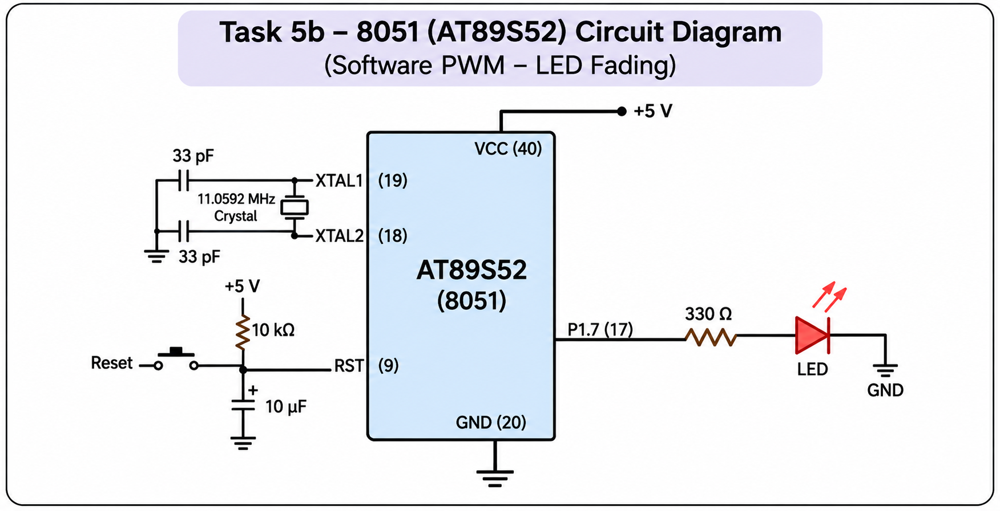

# CONTINUOUS LAB EVALUATION – 5

**COURSE:** Fundamentals of Internet of Things + Lab  
**PLATFORM:** 8051 Microcontroller  
**MICROCONTROLLER:** 8052/8051-compatible microcontroller (`reg52.h`)

## NAME OF EXPERIMENT

Hardware Timer0 and Interrupt-Based LED Toggling Using 8051 Microcontroller

## AIM

To develop an Embedded C program that configures Timer0 in 16-bit Mode 1 and uses periodic timer overflow interrupts to toggle an LED connected to P1.7 at approximately one-second intervals without using software delay loops.

## HARDWARE SETUP / PLATFORM

- 8051/8052-compatible microcontroller development board
- LED
- Current-limiting resistor
- Crystal oscillator and clock circuitry
- Regulated power supply
- Keil µVision IDE
- 8051-compatible programming environment

## TASK NO

**CAT5 – TASK A: TIMER0 INTERRUPT-BASED LED CONTROL**

Configure Timer0 to generate periodic interrupts and establish a software time base for LED toggling.

The LED must change its output logic state approximately once every second using timer interrupts rather than blocking software delays.

## PIN CONFIGURATION

| Component | Pin / Register | Function |
|---|---|---|
| LED | P1.7 | Digital output |
| Timer0 | TH0, TL0 | 16-bit timer registers |
| TMOD | Timer0 mode bits | Timer configuration |
| ET0 | IE.1 | Timer0 interrupt enable |
| EA | IE.7 | Global interrupt enable |
| TR0 | TCON.4 | Timer0 start/stop control |

The LED is controlled through the `sbit` declaration:

` sbit LED = P1^7; `

The physical LED illumination depends on whether the board uses an active-HIGH or active-LOW LED connection.

## WORKING PRINCIPLE

### 1. Timer0 Configuration

Timer0 is configured in Mode 1, which provides 16-bit timer operation.

The following statement selects Timer0 Mode 1 while preserving the Timer1 configuration bits:

`TMOD = (TMOD & 0xF0) | 0x01;`

The timer registers are loaded with:

- `TH0 = 0xFC`
- `TL0 = 0x66`

The combined preload value is `0xFC66`.

### 2. Timer Preload Calculation

For a conventional 12-clock 8051 operating at 11.0592 MHz:

Machine-cycle frequency:

`11,059,200 / 12 = 921,600 Hz`

Machine-cycle duration:

`12 / 11,059,200 ≈ 1.085 µs`

Timer counts required for approximately 1 ms:

`1 ms / 1.085 µs ≈ 922`

Timer preload:

`65536 − 922 = 64614 = 0xFC66`

Therefore:

- `TH0 = 0xFC`
- `TL0 = 0x66`

This preload gives approximately 1.0004 ms of timer counting per overflow under the stated clock assumptions.

The actual interrupt period also includes interrupt handling and timer reload overhead, so the resulting timing is approximate.

### 3. Timer0 Interrupt Service Routine

The interrupt service routine is declared as:

`void Timer0_ISR(void) interrupt 1`

Interrupt vector 1 corresponds to Timer0 overflow in the 8051 architecture.

Whenever Timer0 overflows, the interrupt service routine executes.

The ISR performs the following operations:

1. Stops Timer0 using `TR0 = 0`.
2. Reloads `TH0` and `TL0` with `0xFC66`.
3. Restarts Timer0 using `TR0 = 1`.
4. Increments the `ms_count` variable.
5. Checks whether `ms_count` has reached 1000.
6. Resets the counter and toggles the LED when the count reaches 1000.

### 4. LED Toggling

The LED is initially assigned logic LOW:

`LED = 0;`

The statement:

`LED = ~LED;`

toggles the LED output bit between logic LOW and HIGH.

After approximately 1000 timer interrupts, the LED changes state.

Thus, the output is designed to toggle approximately once every second, producing a complete HIGH–LOW cycle approximately every two seconds.

### 5. Interrupt Enable and Timer Start

The following statements enable and start the timer:

- `ET0 = 1;` – Enables Timer0 interrupts.
- `EA = 1;` – Enables global interrupts.
- `TR0 = 1;` – Starts Timer0.

The main program then enters an infinite loop.

No software delay function is used in the main loop. The timing operation is handled through Timer0 interrupts.

## ALGORITHM

1. Start the program.
2. Define P1.7 as the LED output pin.
3. Initialize the LED output to LOW.
4. Configure Timer0 in 16-bit Mode 1.
5. Load `TH0 = 0xFC` and `TL0 = 0x66`.
6. Enable Timer0 and global interrupts.
7. Start Timer0.
8. Enter the infinite main loop.
9. On Timer0 overflow, execute the interrupt service routine.
10. Stop and reload Timer0, then restart it.
11. Increment the software counter `ms_count`.
12. When the counter reaches 1000, reset it and toggle P1.7.
13. Repeat the process continuously.

## SOURCE CODE

```c
#include <reg52.h>

sbit LED = P1^7;

unsigned int ms_count = 0;

void Timer0_ISR(void) interrupt 1
{
    TR0 = 0;
    TH0 = 0xFC;
    TL0 = 0x66;
    TR0 = 1;

    ms_count++;

    if (ms_count >= 1000)
    {
        ms_count = 0;
        LED = ~LED;
    }
}

void main(void)
{
    LED = 0;

    TMOD = (TMOD & 0xF0) | 0x01;
    TH0 = 0xFC;
    TL0 = 0x66;

    ET0 = 1;
    EA = 1;
    TR0 = 1;

    while (1)
    {
        /* Timer interrupt handles LED timing. */
    }
}
```

## EXPECTED OUTPUT

The LED connected to P1.7 changes its output state approximately once every second, assuming an 11.0592 MHz crystal and a conventional 12-clock 8051 timer.

The output follows this approximate sequence:

| Time | P1.7 Logic State |
|---|---|
| Initially | LOW |
| After 1 second | HIGH |
| After 2 seconds | LOW |
| After 3 seconds | HIGH |
| After 4 seconds | LOW |

Actual transition times may differ because of interrupt and reload overhead.

## RESULT

The Embedded C program configures Timer0 in 16-bit Mode 1 and implements periodic LED toggling through Timer0 overflow interrupts.

The implementation uses a software counter to combine approximately 1000 timer interrupts into one LED state change.

## INFERENCE

This experiment demonstrates hardware timer configuration, interrupt-driven execution, timer register preloading, and software time-base generation using the 8051 microcontroller.

Unlike blocking software delay loops, timer interrupts allow the main program to remain available for additional operations.

The accuracy of the output timing depends on the oscillator frequency, timer configuration, and interrupt execution overhead.

## CIRCUIT DIAGRAM



