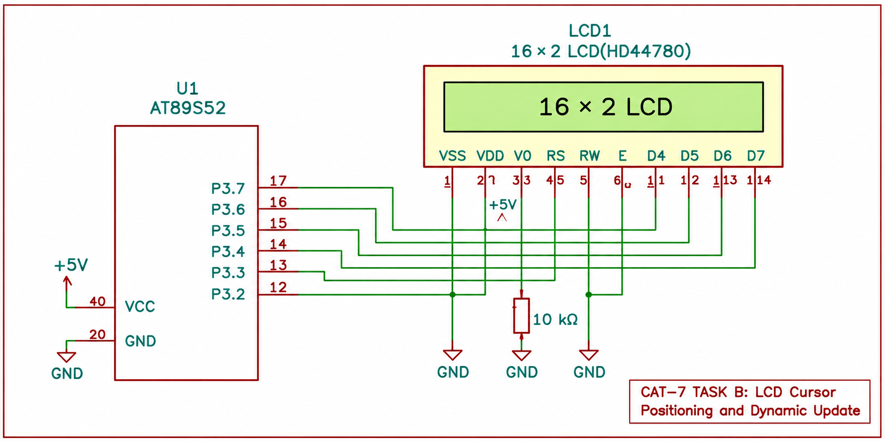

# CONTINUOUS LAB EVALUATION – 7

**DATE:** 24-08-2026

## NAME OF EXPERIMENT

LCD Cursor Positioning and Dynamic Value Update

## HARDWARE SETUP / PLATFORM

- 8051 Toolchain Setup
- AT89S52 Development Board
- 16×2 HD44780-Compatible LCD
- Board Schematics and LCD Datasheet

## TASK NO

**TASK 7B: CURSOR POSITIONING AND DYNAMIC VALUE UPDATE**

Develop an LCD application using bare-metal Embedded C to position the cursor, display strings and numerical values, and update the displayed information dynamically.

## PROBLEM STATEMENT

Interface a 16×2 LCD with the AT89S52 microcontroller using a 4-bit parallel interface.

Develop functions to control the cursor position and display strings and numerical values on the LCD using DDRAM addressing.

## FUNCTIONAL REQUIREMENTS

1. Initialize the LCD in 4-bit, 2-line mode.
2. Position the cursor at a specified row and column.
3. Display character strings at the selected cursor position.
4. Display numerical values on the LCD.
5. Update displayed values dynamically.
6. Use DDRAM addresses to access the required display positions.

## REQUIRED FUNCTIONS

```c
lcd_goto(row, column);
lcd_puts(string);
lcd_print_number(value);
```

## LCD DISPLAY ORGANIZATION

| Parameter | Description |
|---|---|
| LCD Type | HD44780-Compatible |
| Display Size | 16×2 |
| Interface Mode | 4-bit |
| Display Rows | 2 |
| Characters per Row | 16 |
| Character Font | 5×8 |

The LCD controller maintains an internal Display Data RAM (DDRAM) to store displayed characters.

The first and second rows correspond to different DDRAM address ranges. Cursor positioning is performed by sending the appropriate DDRAM address command.

## TOPICS / CONSTRAINTS

- AT89S52 Microcontroller
- Bare-Metal Embedded C
- Direct GPIO Register Access
- HD44780 LCD Controller
- 4-bit Parallel LCD Interface
- LCD Cursor Positioning
- DDRAM Addressing
- Character and String Display
- Numerical Value Display
- Dynamic LCD Updating

**Implementation Constraints:**

- Do not use Arduino APIs.
- Do not use HAL libraries.
- Do not use RTOS services.
- Use direct GPIO access.
- Configure the LCD in 4-bit, 2-line mode.
- Refer to the HD44780-compatible LCD datasheet for the relevant commands.

## CORE LOGIC / PSEUDOCODE

1. Initialize the LCD using the required initialization sequence.
2. Configure the LCD for 4-bit, 2-line operation.
3. Identify the required row and column.
4. Determine the corresponding DDRAM address.
5. Send the cursor-positioning command to the LCD.
6. Display the required string using the LCD data function.
7. Convert numerical values into displayable characters.
8. Display the numerical values at the selected position.
9. Update the displayed values when required.

## INFERENCE

The experiment demonstrates cursor positioning and dynamic information display using the AT89S52 microcontroller and an HD44780-compatible 16×2 LCD.

It provides an understanding of DDRAM addressing, string display, numerical value conversion and dynamic LCD updates through direct GPIO interfacing.

## CIRCUIT DIAGRAM

