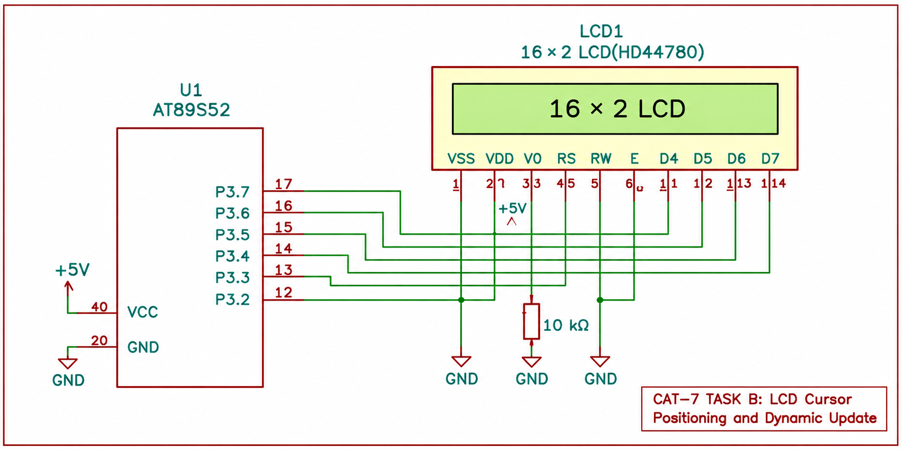

# CONTINUOUS LAB EVALUATION – 7

**DATE:** 24-08-2026

## NAME OF EXPERIMENT

4×4 Matrix Keypad-Based Character Movement on 16×2 LCD

## HARDWARE SETUP / PLATFORM

- 8051 Toolchain Setup
- AT89S52 Development Board
- 16×2 HD44780-Compatible LCD
- 4×4 Matrix Keypad
- Board Schematics and LCD Datasheet

## TASK NO

**TASK 7C: KEYPAD-BASED CHARACTER MOVEMENT**

Develop an interactive LCD application using bare-metal Embedded C programming in which a character moves across a 16×2 LCD based on directional inputs from a 4×4 matrix keypad.

## PROBLEM STATEMENT

Interface a 16×2 HD44780-compatible LCD and a 4×4 matrix keypad with the AT89S52 microcontroller.

Display a character on the LCD and allow the user to move it in four directions using designated keypad keys.

The LCD must update the character position according to the detected key press.

## FUNCTIONAL REQUIREMENTS

1. Initialize the LCD in 4-bit, 2-line mode.
2. Interface the 4×4 matrix keypad with the microcontroller.
3. Scan the keypad to identify the pressed key.
4. Display the character `O` at the initial LCD position.
5. Move the character UP, DOWN, LEFT or RIGHT according to the selected key.
6. Erase the character from its previous position before displaying it at the new position.
7. Restrict movement to the valid 16×2 LCD boundaries.
8. Implement switch debouncing and key-release detection to ensure one movement per key press.

## KEYPAD FUNCTIONAL REQUIREMENTS

| Key Press | Direction | Operation |
|---|---|---|
| 2 | UP | Move the character to the previous row |
| 8 | DOWN | Move the character to the next row |
| 4 | LEFT | Move the character one column left |
| 6 | RIGHT | Move the character one column right |

## GPIO PIN CONFIGURATION

### LCD CONNECTIONS

| LCD Signal | AT89S52 GPIO |
|---|---|
| RS | P3.2 |
| E | P3.3 |
| D4 | P3.4 |
| D5 | P3.5 |
| D6 | P3.6 |
| D7 | P3.7 |
| RW | GND |

### MATRIX KEYPAD CONNECTIONS

| Keypad Pin | AT89S52 GPIO |
|---|---|
| Row 1 | P1.0 |
| Row 2 | P1.1 |
| Row 3 | P1.2 |
| Row 4 | P1.3 |
| Column 1 | P1.4 |
| Column 2 | P1.5 |
| Column 3 | P1.6 |
| Column 4 | P1.7 |

## REQUIRED FUNCTIONS

```c
void lcd_init(void);
void lcd_cmd(unsigned char cmd);
void lcd_data(unsigned char datas);
void lcd_goto(unsigned char row, unsigned char column);
unsigned char keypad_scan(void);
void wait_key_release(void);
```

## LCD DISPLAY ORGANIZATION

| Parameter | Configuration |
|---|---|
| LCD Type | HD44780-Compatible |
| Display Size | 16×2 |
| Interface Mode | 4-bit |
| Number of Rows | 2 |
| Columns per Row | 16 |
| Character Font | 5×8 |

The LCD uses DDRAM addressing to position the cursor.

- Row 0 starts at DDRAM address `0x00`.
- Row 1 starts at DDRAM address `0x40`.
- Valid row positions are 0 and 1.
- Valid column positions are 0 to 15.

## KEYPAD SCANNING

The 4×4 matrix keypad consists of four rows and four columns.

The keypad scanning process involves:

1. Configure the keypad rows as outputs and columns as inputs.
2. Drive one row LOW at a time.
3. Read the column inputs to detect a pressed key.
4. Identify the corresponding row and column.
5. Determine the pressed key using the keypad mapping.
6. Apply a debounce delay.
7. Wait for the key to be released before accepting another movement.

## TOPICS / CONSTRAINTS

- AT89S52 Microcontroller
- Bare-Metal Embedded C Programming
- Direct GPIO Register Access
- HD44780 LCD Controller
- 4-bit Parallel LCD Interfacing
- LCD Initialization
- DDRAM Addressing
- Cursor Positioning
- 4×4 Matrix Keypad Interfacing
- Keypad Scanning
- Switch Debouncing
- Character Movement and Display Updating

**Implementation Constraints:**

- Do not use Arduino APIs.
- Do not use HAL libraries.
- Do not use RTOS services.
- Use direct GPIO register access.
- Configure the LCD in 4-bit, 2-line mode.
- Use the keypad for directional movement.
- Restrict character movement within the LCD boundaries.

## CORE LOGIC / PSEUDOCODE

1. Initialize the GPIO pins for the LCD and keypad.
2. Configure the LCD for 4-bit, 2-line operation.
3. Set the initial character position to row 0, column 0.
4. Display the character `O` at the initial position.
5. Continuously scan the matrix keypad.
6. Detect a valid key press.
7. Erase the character from its previous position.
8. Update the character position according to the pressed key:
   - Key 2: Move UP if row is greater than 0.
   - Key 8: Move DOWN if row is less than 1.
   - Key 4: Move LEFT if column is greater than 0.
   - Key 6: Move RIGHT if column is less than 15.
9. Display the character at the updated position.
10. Wait for the key to be released.
11. Repeat for subsequent keypad inputs.

## INFERENCE

The experiment demonstrates interactive character movement on a 16×2 LCD using the AT89S52 microcontroller and a 4×4 matrix keypad.

It provides an understanding of LCD interfacing, cursor positioning, DDRAM addressing, keypad scanning, switch debouncing and dynamic display updating.

The experiment illustrates the development of a basic embedded human-machine interface using bare-metal Embedded C programming and direct GPIO control without Arduino APIs, HAL libraries or RTOS services.

## CIRCUIT DIAGRAM


