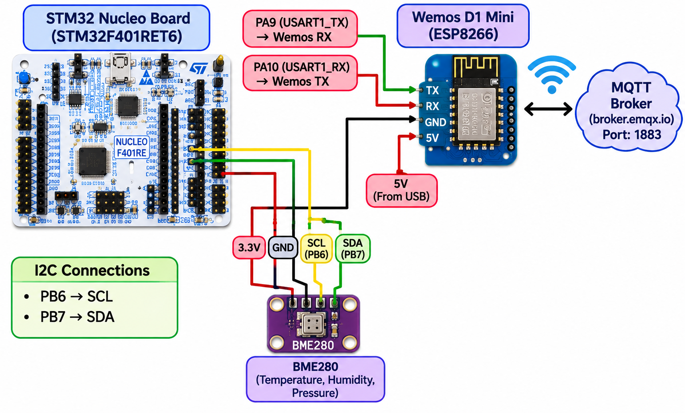
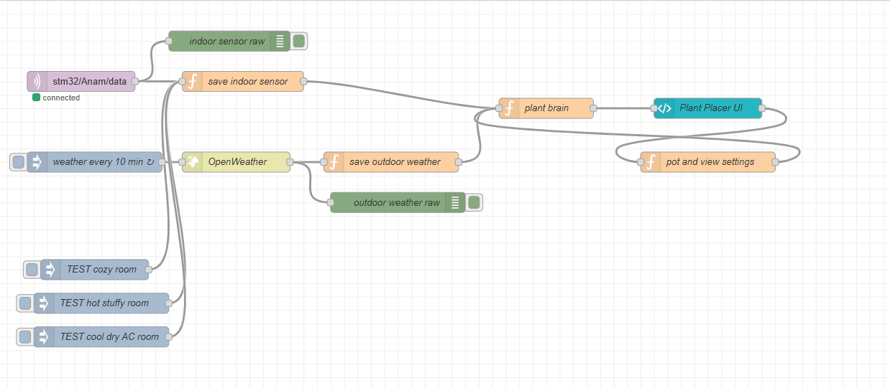
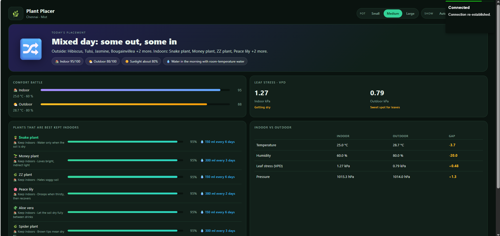
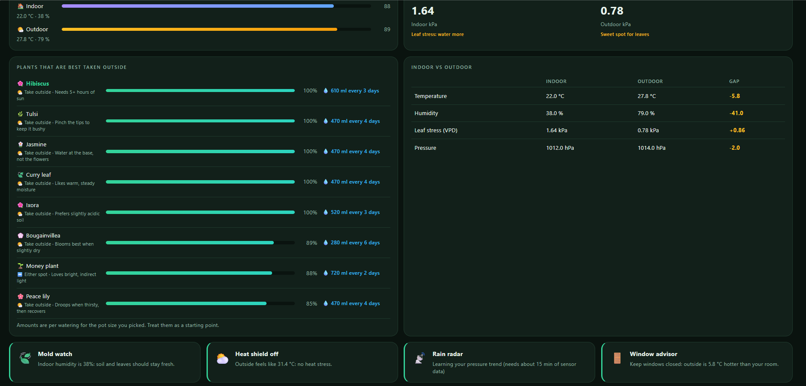
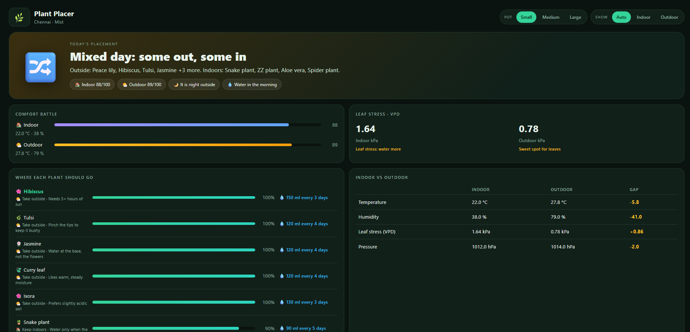

# EXPERIMENT DETAILS

**EXP:** CONTINUOUS LAB EVALUATION – 15

**DATE:** 27/10/2026

**NAME OF EXP:** BME280 Sensor Interfacing Using I²C and MQTT for Node-RED Analytics

**HARDWARE SETUP / PLATFORM:** CubeMX + Keil MDK + STM32 Nucleo Development Board + Debugger + BME280 Sensor + ESP8266 Wi-Fi Module

---
# Plant Placer – Smart Indoor/Outdoor Plant Placement Advisor

## PROJECT DETAILS

| Item | Description |
|---|---|
| Project Name | Plant Placer |
| Project Type | IoT-based Environmental Monitoring and Plant Placement Advisor |
| Microcontroller | STM32 Nucleo-F401RE |
| Indoor Sensor | BME280 |
| Wireless Communication | ESP8266 / Wemos |
| Messaging Protocol | MQTT |
| Data Processing and Dashboard | Node-RED |
| Outdoor Weather Data | OpenWeather API |

## AIM

To develop an STM32-based environmental monitoring system that reads temperature, humidity and atmospheric pressure from a BME280 sensor using the I²C protocol. The measured indoor environmental data is transmitted through an ESP8266 module using MQTT.

Node-RED receives the indoor sensor data and obtains outdoor weather information from the OpenWeather API. It compares indoor and outdoor conditions and provides plant-placement recommendations, plant-fit scores and watering guidance through a dashboard.

The system is designed to help decide whether selected plants should be kept indoors or moved outdoors based on the available environmental information.

## 1. HARDWARE SETUP

### Hardware Components

| Component | Purpose |
|---|---|
| STM32 Nucleo-F401RE | Main microcontroller; reads and processes BME280 measurements |
| BME280 sensor | Measures temperature, relative humidity and atmospheric pressure |
| ESP8266 / Wemos | Provides Wi-Fi connectivity and MQTT communication |
| Connecting wires | Connect the sensor and communication module to the STM32 board |
| USB connection | Programming and serial debugging of the STM32 board |

### Circuit Diagram



### Pin Configuration

| Module | STM32 connection | Interface | Purpose |
|---|---|---|---|
| BME280 SCL | PB6 | I²C1 SCL (configured/intended) | I²C clock |
| BME280 SDA | PB7 | I²C1 SDA (configured/intended) | I²C data |
| ESP8266 / Wemos | USART1 pins as configured in CubeMX | UART1 | Communication between STM32 and ESP8266 |

## 2. SOFTWARE AND TOOLS

- STM32CubeMX – peripheral and clock configuration.
- Keil MDK – STM32 firmware development and compilation.
- STM32 HAL – I²C and UART peripheral functions.
- Custom ESP8266 library – Wi-Fi and MQTT communication.
- MQTT broker – transfers sensor messages to Node-RED.
- Node-RED – receives, stores and analyses sensor/weather data.
- OpenWeather API – provides outdoor weather information.
- Node-RED Dashboard (`ui-template`) – displays plant recommendations and environmental information.

## 3. SYSTEM WORKFLOW

1. The BME280 measures indoor temperature, relative humidity and atmospheric pressure.
2. The STM32 communicates with the BME280 through I²C.
3. The STM32 prepares the compensated sensor readings in JSON format.
4. The custom ESP8266 library sends the data to an MQTT broker.
5. Node-RED subscribes to the MQTT topic and receives the indoor sensor data.
6. A Node-RED function parses and stores the latest indoor readings. It also keeps pressure samples for trend analysis.
7. An Inject node triggers the OpenWeather request periodically. The returned outdoor weather data is processed and stored.
8. The Plant Brain function compares the indoor and outdoor conditions, calculates plant-fit scores and generates placement and watering recommendations.
9. The dashboard displays the results. The pot-size and view controls send their selected settings back to the flow.

### MQTT Data Format

The STM32 publishes a JSON message containing the sensor measurements. The example format specified for the project is:

```json
{
  "temperature": 28.45,
  "humidity": 62.30,
  "pressure": 1008.72
}
```

The actual MQTT topic shown in the supplied Node-RED flow is:

```text
stm32/Anam/data
```

The MQTT broker and topic must match the configuration used by the STM32 ESP8266 library and the Node-RED MQTT-in node.

## 4. NODE-RED FLOW AND IMPLEMENTATION

### Node-RED Flow




### Main Nodes and Their Functions

| Node / Function | Description |
|---|---|
| MQTT input (`stm32/Anam/data`) | Receives the indoor sensor JSON message |
| `indoor sensor raw` | Debug node used to inspect incoming sensor messages |
| `save indoor sensor` | Parses the payload, stores the latest sensor readings and maintains pressure history |
| `weather every 10 min` | Inject node that triggers an outdoor weather request periodically |
| `OpenWeather` | Requests current outdoor weather information |
| `outdoor weather raw` | Debug node used to inspect the weather response |
| `save outdoor weather` | Extracts and stores outdoor temperature, humidity, pressure, wind, rain, cloud cover and related fields |
| `plant brain` | Performs environmental comparison, plant-fit calculations, placement decisions and watering guidance |
| `Plant Placer UI` | Displays the results on the dashboard |
| `pot and view settings` | Processes the selected pot size and plant-list view from the dashboard |
| Test Inject nodes | Provide test indoor conditions for checking the flow |

### Indoor Sensor Processing

The `save indoor sensor` function:
- Accepts the MQTT payload and parses it if it arrives as a string.
- Checks that the message contains valid sensor data.
- Adds a timestamp and stores the latest readings in Node-RED flow context.
- Saves pressure samples at intervals of at least 30 seconds.
- Retains a maximum of 120 pressure samples for trend analysis.

The Plant Brain considers indoor sensor data stale if it is more than **2 minutes** old.

### Outdoor Weather Processing

The `save outdoor weather` function extracts and stores:
- Temperature and feels-like temperature.
- Relative humidity and atmospheric pressure.
- Weather condition and description.
- Wind speed and rainfall during the last hour.
- Cloud cover and day/night information.

The weather request is triggered by the Inject node at a 10-minute interval. The Plant Brain considers outdoor weather data stale if it is more than **1 hour** old.

### Pot and View Settings

The dashboard sends settings in the form `pot:<size>` or `view:<mode>`.

Supported pot sizes:
- Small
- Medium
- Large

Supported view modes:
- **Auto** – displays plants from all placement categories.
- **Indoor** – filters the list to plants recommended indoors and plants for which either location is suitable.
- **Outdoor** – filters the list to plants recommended outdoors and plants for which either location is suitable.

These view options filter the displayed list; they do not replace the placement calculation.

## 5. CORE LOGIC – PLANT PLACEMENT

### A. Indoor and Outdoor Comparison

The Plant Brain reads the latest indoor sensor values and outdoor weather values from Node-RED flow context. It calculates overall comfort scores for indoor and outdoor conditions using temperature, humidity, VPD and selected weather penalties.

The scores are displayed as a comparison to help understand the current environmental conditions. They are heuristic scores generated by the program, not measurements from a separate plant-health sensor.

### B. Vapour Pressure Deficit (VPD)

VPD (Vapour Pressure Deficit) is used as an indicator of how strongly the surrounding air can draw moisture from plant leaves.

The program calculates VPD using:

```text
VPD = 0.6108 × exp((17.27 × T) / (T + 237.3)) × (1 − H / 100)
```

Where:
- `T` is temperature in °C.
- `H` is relative humidity in percent.
- The calculated VPD is expressed in kPa.

The program labels VPD values as:
- Below 0.4 kPa – Too damp: mold risk.
- 0.4 to 1.2 kPa – Sweet spot for leaves.
- Above 1.2 to 1.6 kPa – Getting dry.
- Above 1.6 kPa – Leaf stress: water more.

VPD is an environmental estimate. It does not directly measure soil moisture or the actual water content of a plant.

### C. Plant Database and Fit Score

The program contains a predefined list of 12 plants, each with:
- A preferred indoor or outdoor location.
- A minimum and maximum temperature range.
- A minimum and maximum humidity range.
- A watering-need multiplier.
- A short plant-care tip.

The list includes Snake plant, Money plant, ZZ plant, Peace lily, Aloe vera, Spider plant, Hibiscus, Tulsi, Jasmine, Bougainvillea, Curry leaf and Ixora.

For each plant, the program calculates a fit score for both indoor and outdoor conditions. It considers the plant's configured temperature and humidity ranges, VPD penalty, outdoor weather penalties and a penalty when the plant is evaluated in a location different from its predefined home location.

The difference between the outdoor and indoor fit scores determines the recommendation:
- Outdoor fit is at least 8 points higher – recommend taking the plant outside.
- Indoor fit is at least 8 points higher – recommend keeping the plant indoors.
- Difference is less than 8 points – either location is considered suitable; the plant's predefined home location is used for the associated watering advice.

### D. Weather and Pressure-Based Checks

The system also considers:
- Rainfall and weather condition from OpenWeather.
- High feels-like temperature.
- High wind speed.
- Rainfall amount.
- Changes in indoor atmospheric pressure over time.

Pressure samples are collected over time. Once at least 15 minutes of data is available, the program estimates the pressure change per hour. A sufficiently falling pressure trend is treated as a possible indication that rain may be approaching. This is a simple heuristic, not a guaranteed rain forecast.

### E. Watering Guidance

The program estimates watering amount and interval using:
- Selected pot size.
- The plant's predefined watering-need multiplier.
- The VPD-based environmental factor.

The configured base amounts are 150 ml for a small pot, 300 ml for a medium pot and 600 ml for a large pot. The calculated amount is adjusted for the plant and environmental factor.

Outdoor watering advice is also modified when rain is detected or when the pressure trend suggests possible approaching rain. The dashboard reminds the user to check the soil before watering.

**Important:** Watering amounts and intervals are estimates based on programmed rules. The project does not currently use a soil-moisture sensor, so the recommendation cannot confirm whether the soil is actually dry or wet.

## 6. DASHBOARD

### Plant Placer Dashboard







The dashboard provides a visual comparison of indoor and outdoor environmental conditions and displays plant-placement recommendations.

### Dashboard Features

1. **Today's Placement** – displays an overall verdict such as a mixed indoor/outdoor recommendation.
2. **Indoor and Outdoor Comfort Scores** – shows the calculated environmental scores for both locations.
3. **Plant Placement List** – displays individual plant recommendations and fit percentages.
4. **VPD Display** – shows indoor and outdoor VPD values and their descriptive labels.
5. **Indoor vs Outdoor Comparison** – compares temperature, humidity, VPD and atmospheric pressure.
6. **Watering Guidance** – estimates watering amount and interval based on pot size and plant settings.
7. **Pot Size Selection** – allows the user to select small, medium or large pot settings.
8. **Plant View Selection** – allows the list to be filtered using Auto, Indoor or Outdoor.
9. **Weather and Warning Cards** – displays information such as humidity/mold watch, heat warning, rain/pressure trend and window advice.
10. **Sunlight Estimate** – displays an estimate derived from OpenWeather cloud-cover information. It is not a direct measurement from a light sensor.

## 7. CLOCK CONFIGURATION

The exact clock configuration values are not included in the material supplied for this README. Add the values from the final STM32CubeMX clock configuration if your report requires a clock table.

| Parameter | Configured value |
|---|---|
| System clock source | Confirm from STM32CubeMX |
| SYSCLK | Confirm from STM32CubeMX |
| AHB / APB prescalers | Confirm from STM32CubeMX |
| I²C1 | BME280 communication |
| USART1 | ESP8266 communication |

## 8. INFERENCE

The project integrates STM32-based indoor environmental sensing with outdoor weather information through MQTT and Node-RED. The BME280 provides indoor temperature, humidity and pressure readings, while OpenWeather supplies outdoor weather data.

Node-RED processes both data sources and uses programmed environmental rules to compare indoor and outdoor conditions. The Plant Brain evaluates the configured requirements of each plant and generates placement suggestions, fit scores and watering guidance. The dashboard presents this information in an accessible visual form and allows the user to change pot size and filter the plant list.

The system demonstrates the integration of embedded sensing, I²C, UART-based ESP8266 communication, MQTT, API-based weather retrieval, Node-RED processing and dashboard visualization.

