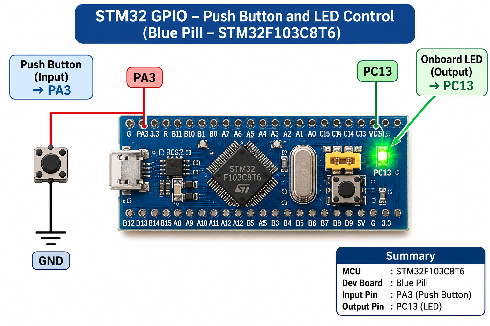

# EXPERIMENT DETAILS

**EXP:** CONTINUOUS ASSESSMENT 8

**DATE:** 18/09/2026

**NAME OF EXP:** STM32 GPIO Bring-Up and Switch-Controlled LED

**HARDWARE SETUP / PLATFORM:** STM32CubeMX + Keil MDK + STM32 Development Board (Blue Pill – STM32F103C8T6)

---

## TASK 8A – GPIO Input/Output

### 1. Circuit Diagram

The experiment uses a push-button connected to the STM32 GPIO input pin and the onboard LED connected to the GPIO output pin.

- **Development Board:** STM32 Blue Pill
- **Microcontroller IC:** STM32F103C8T6
- **GPIO Input Pin:** PA3 – Push-button
- **GPIO Output Pin:** PC13 – Onboard LED
- **Button Configuration:** Input with internal pull-up resistor
- **LED Configuration:** Output push-pull

**Hardware Connections:**

- Connect one terminal of the push-button to PA3.
- Connect the other terminal of the push-button to GND.
- The onboard LED is controlled through PC13.

### 2. Core Logic / Pseudocode / Code Base

**Working Principle:**

This experiment demonstrates GPIO input and output operations using the STM32 HAL library.

The GPIO pin PA3 is configured as an input with an internal pull-up resistor. When the push-button is pressed, PA3 reads LOW (GPIO_PIN_RESET). When the button is released, PA3 reads HIGH (GPIO_PIN_SET).

The onboard LED connected to PC13 follows the push-button state. When the button is pressed, the LED turns ON. When the button is released, the LED turns OFF.

A 20 ms delay is introduced after detecting a button press to reduce the effect of switch bouncing.

**Pseudocode:**

1. Initialize the HAL library.
2. Configure the system clock.
3. Initialize GPIO peripherals.
4. Configure PA3 as an input with an internal pull-up resistor.
5. Configure PC13 as an output push-pull pin.
6. Continuously read the state of PA3.
7. If the button is pressed (LOW):
   - Introduce a 20 ms delay.
   - Read the button state again.
   - If it is still LOW, turn ON the LED.
8. If the button is released (HIGH), turn OFF the LED.
9. Repeat the process continuously.

**Code Base:**

The experiment uses the following STM32 HAL functions:

| Purpose | HAL Function |
|---|---|
| Read push-button state | `HAL_GPIO_ReadPin()` |
| Control LED state | `HAL_GPIO_WritePin()` |
| Introduce debounce delay | `HAL_Delay()` |
| Initialize GPIO | `HAL_GPIO_Init()` |
| Initialize HAL library | `HAL_Init()` |

### 3. INFERENCE

The experiment successfully demonstrates GPIO input and output interfacing using the STM32 Blue Pill development board. The push-button connected to PA3 controls the onboard LED connected to PC13. The LED turns ON when the button is pressed and turns OFF when the button is released.

The experiment demonstrates digital input reading, output control and basic switch debouncing using STM32 HAL functions.
