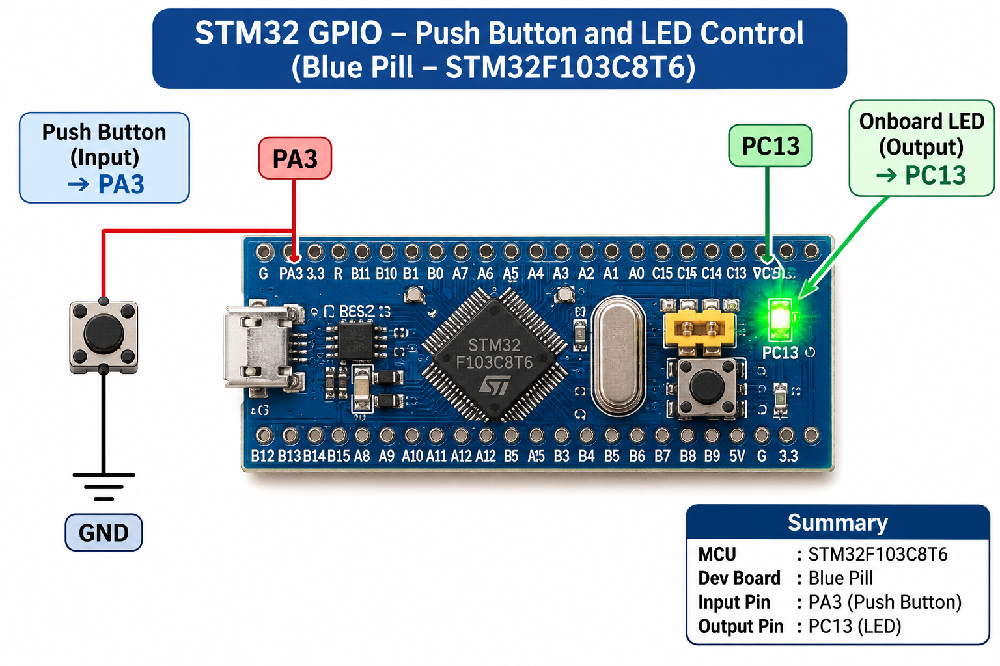

# CONTINUOUS LAB EVALUATION – 8

**DATE:** 18/09/2026  
**COURSE:** 25CS2741 – Fundamentals of Internet of Things + Lab  
**PLATFORM:** STM32 Development Board (Blue Pill / Nucleo)  
**TOOLS:** STM32CubeMX, Keil MDK, STM32 HAL Libraries

## NAME OF EXPERIMENT
STM32 GPIO Bring-Up and Switch-Controlled LED

## TASK NO
Task 8A – GPIO Input/Output

## AIM
To interface a push-button switch and an LED with an STM32 microcontroller and configure GPIO pins so that the LED follows the state of the switch.

## HARDWARE REQUIREMENTS
- STM32 development board (Blue Pill / Nucleo)
- Push-button switch
- LED
- Current-limiting resistor
- Connecting wires and suitable power supply

## SOFTWARE REQUIREMENTS
- STM32CubeMX
- Keil MDK
- STM32 HAL Libraries

## FUNCTIONAL REQUIREMENTS
1. Configure one GPIO pin as digital input for the push-button.
2. Configure one GPIO pin as digital output for the LED.
3. Continuously read the switch state.
4. Turn the LED ON when the switch is pressed.
5. Turn the LED OFF when the switch is released.

## CORE LOGIC / PSEUDOCODE
1. Initialize the HAL library and system clock.
2. Initialize the configured GPIO pins.
3. Enter the infinite application loop.
4. Read the switch using `HAL_GPIO_ReadPin()`.
5. If the switch is pressed, set the LED output to its ON state using `HAL_GPIO_WritePin()`.
6. Otherwise, set the LED output to its OFF state.
7. Repeat continuously.

## IMPORTANT HAL FUNCTIONS
- `HAL_GPIO_ReadPin()` – Reads the current input state.
- `HAL_GPIO_WritePin()` – Controls the LED output.

## EXPECTED OUTPUT
The LED follows the push-button state. It turns ON while the button is pressed and turns OFF when released.

## INFERENCE
This task demonstrates basic STM32 GPIO configuration, digital input reading, and digital output control using HAL functions.

## CIRCUIT DIAGRAM

