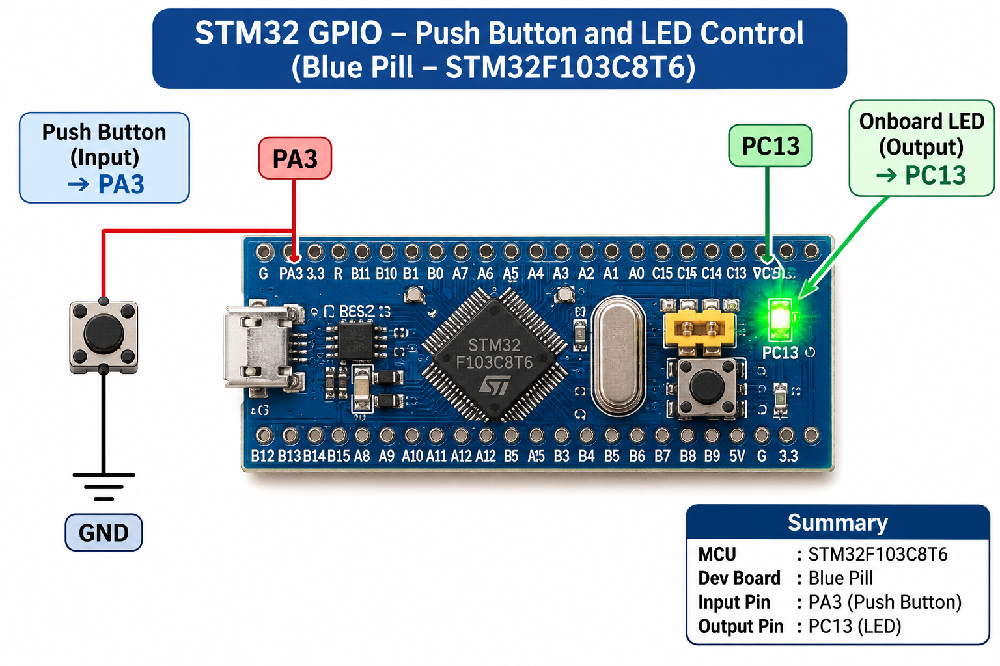

# CONTINUOUS LAB EVALUATION – 8

**DATE:** 18/09/2026  
**COURSE:** 25CS2741 – Fundamentals of Internet of Things + Lab  
**PLATFORM:** STM32 Development Board (Blue Pill / Nucleo)  
**TOOLS:** STM32CubeMX, Keil MDK, STM32 HAL Libraries

## NAME OF EXPERIMENT
STM32 GPIO Bring-Up and Switch-Controlled LED

## TASK NO
Task 8B – Event-Based Control

## AIM
To implement event-based LED toggling using a push-button and software debouncing so that each valid button press produces exactly one LED toggle.

## HARDWARE REQUIREMENTS
- STM32 development board (Blue Pill / Nucleo)
- Push-button switch
- LED
- Current-limiting resistor
- Connecting wires and suitable power supply

## SOFTWARE REQUIREMENTS
- STM32CubeMX
- Keil MDK
- STM32 HAL Libraries

## FUNCTIONAL REQUIREMENTS
1. Configure the push-button as a GPIO input.
2. Configure the LED as a GPIO output.
3. Detect individual button-press events.
4. Toggle the LED state for each valid press.
5. Investigate mechanical switch bouncing.
6. Implement software debouncing to prevent multiple toggles from a single press.

## CORE LOGIC / PSEUDOCODE
1. Initialize HAL, the system clock, and GPIO.
2. Read the current push-button state.
3. Detect a change from released to pressed.
4. Validate the change using a software debounce interval.
5. Once a stable press is confirmed, toggle the LED using `HAL_GPIO_TogglePin()`.
6. Do not toggle repeatedly while the button remains pressed.
7. Wait for a valid release before recognizing another press.
8. Continue monitoring the switch.

## IMPORTANT HAL FUNCTIONS
- `HAL_GPIO_ReadPin()` – Reads the button state.
- `HAL_GPIO_TogglePin()` – Toggles the LED.
- `HAL_GetTick()` – Provides a millisecond time base for debounce timing.

## EXPECTED OUTPUT
- First valid press: LED changes state.
- Second valid press: LED changes state again.
- Each subsequent valid press: exactly one toggle.
- Mechanical switch bounce does not cause unwanted repeated toggles.

## INFERENCE
This task demonstrates event-based GPIO control, switch edge detection, and software debouncing for reliable digital input handling.

## CIRCUIT DIAGRAM

