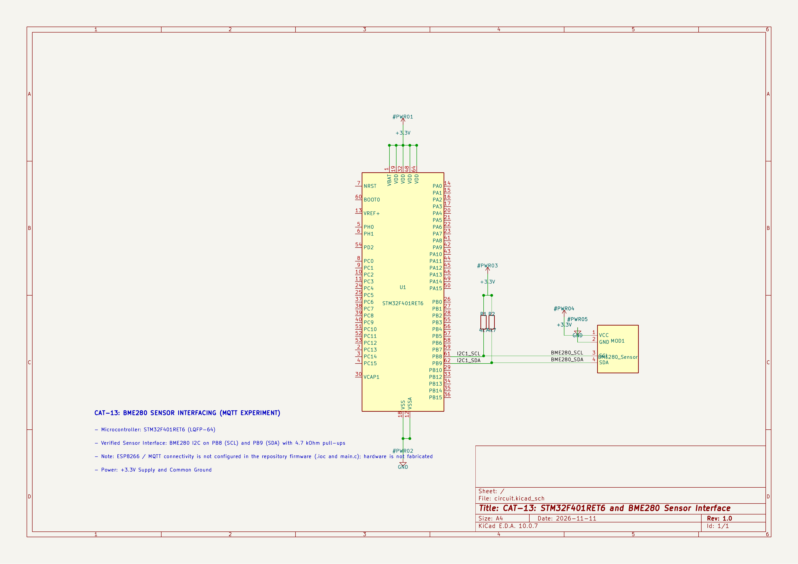

# CONTINUOUS LAB EVALUATION – 13

**DATE:** 27-10-2026

**COURSE:** 25CS2741 – Fundamentals of Internet of Things + Lab

## NAME OF EXPERIMENT

BME280 Sensor Interfacing Using I²C, MQTT Communication and Node-RED Analytics

## HARDWARE SETUP / PLATFORM

- STM32 Nucleo Development Board
- BME280 Temperature, Pressure and Humidity Sensor
- Wemos D1 Mini / ESP8266 Wi-Fi Module
- STM32CubeMX
- Keil MDK / Keil µVision
- STM32 HAL Libraries
- Bosch BME280 Sensor API
- Custom-Built ESP8266 API (MQTT)
- MQTT Broker
- Node-RED
- Debugger
- I²C and UART Communication Interfaces

## TASK NO

Develop an STM32-based environmental sensing application to interface a BME280 sensor using the I²C protocol and obtain compensated temperature, pressure and humidity measurements.

Transmit the sensor data over Wi-Fi using MQTT through the custom-built ESP8266 API.

Use Node-RED to receive the MQTT messages and visualize the environmental parameters for analytics.

## STEP 1: DOWNLOAD AND ARRANGE THE DRIVER FILES

Use the custom-built ESP8266 library provided in the shared repository.

### REQUIRED DRIVER FILES

- `ESPLib.c`
- `ESPLib.h`

### FILE ORGANIZATION

Arrange the library files in the STM32 project.

```text
STM32_Project/
├── Core/
│   ├── Inc/
│   │   └── ESPLib.h
│   └── Src/
│       └── ESPLib.c
```

The required source and header files must be included in the project before implementing MQTT communication.

## STEP 2: INCLUDE THE FILES IN KEIL µVISION

### FUNCTIONAL REQUIREMENTS

1. Open the STM32 project in Keil µVision.
2. Expand the target folder.
3. Locate the Application/User/Core group.
4. Right-click the group and select **Add Existing Files to Group**.
5. Add the required source file from `Core/Src`.
6. Open **Options for Target**.
7. Navigate to the C/C++ settings.
8. Verify that the required include directory is configured.
9. Ensure the header files are accessible during compilation.

## STEP 3: IMPLEMENT THE ESP8266 MQTT INTERFACE

Open `main.c` and configure the ESP8266 module using the custom-built API.

### FUNCTIONAL REQUIREMENTS

1. Initialize the ESP8266 module.
2. Configure the ESP8266 in Wi-Fi station mode.
3. Connect to a local Wi-Fi network.
4. Establish a TCP connection with an MQTT broker.
5. Configure MQTT client parameters.
6. Establish the MQTT connection.
7. Publish or subscribe to MQTT topics.
8. Handle MQTT communication using the provided library functions.

### ESP8266 INITIALIZATION

```c
ESP8266_Init(StationMode, huart2);
```

### WI-FI CONNECTION

```c
ESP8266_wifiConnect("SSID", "PASSWORD");
```

### MQTT BROKER CONNECTION

```c
ESP8266_portConnect("TCP", "broker.emqx.io", "1883");
```

Port `1883` is used for standard unencrypted MQTT communication.

### MQTT CLIENT CONFIGURATION

```c
MQTT_InitTypeDef_t mqttSetting;

mqttSetting.keepAlive = 500;
mqttSetting.connectFlag = CleanSession;
mqttSetting.clientID = "MqttID";

MQTT_connectBroker(&mqttSetting);
```

The MQTT client parameters are configured before connecting to the broker.

## MQTT PUBLISHING

Develop an application to publish data to an MQTT topic.

### FUNCTIONAL REQUIREMENTS

1. Initialize the ESP8266 Wi-Fi module.
2. Connect to the selected Wi-Fi network.
3. Establish a TCP connection with the MQTT broker.
4. Configure the MQTT client.
5. Publish data to the selected MQTT topic.
6. Repeat the publishing operation periodically.

### MQTT PUBLISHING FUNCTION

```c
MQTT_publishTopic("stm32/test/data", "hello", QoS0);
```

### PUBLISHING LOOP

```c
while (1)
{
    MQTT_publishTopic("stm32/test/data", "hello", QoS0);
    HAL_Delay(1000);
}
```

### MQTT PUBLISHING PARAMETERS

| Parameter | Configuration |
|---|---|
| MQTT Broker | `broker.emqx.io` |
| Port | `1883` |
| Topic | `stm32/test/data` |
| Message | `hello` |
| QoS | QoS 0 |
| Publishing Interval | 1000 ms |

These values correspond to the publishing example provided in the evaluation sheet.

## MQTT SUBSCRIBING

Develop an application to subscribe to an MQTT topic and receive messages.

### FUNCTIONAL REQUIREMENTS

1. Initialize the ESP8266 Wi-Fi module.
2. Connect to the Wi-Fi network.
3. Establish a connection with the MQTT broker.
4. Configure MQTT client parameters.
5. Subscribe to the required MQTT topic.
6. Enable UART interrupt-based reception.
7. Process the received MQTT messages.

### MQTT SUBSCRIPTION

```c
MQTT_subscribeTopic("IOT", 0);
```

### UART INTERRUPT RECEPTION

```c
HAL_UART_Receive_IT(&huart2, &uartRxData, 1);
```

### MQTT DATA HANDLING

```c
while (1)
{
    MQTTDataHandler(mqttTopic, mqttData);
}
```

### MQTT SUBSCRIPTION PARAMETERS

| Parameter | Configuration |
|---|---|
| Topic | `IOT` |
| QoS | 0 |
| UART | USART2 |
| Reception | Interrupt-Based |
| Data Processing | `MQTTDataHandler()` |

## MQTT TIMER HANDLING

The evaluation sheet specifies the MQTT timer function inside the SysTick interrupt handler.

### REQUIRED FUNCTION

```c
void SysTick_Handler(void)
{
    /* USER CODE BEGIN SysTick_IRQn 0 */
    MQTTTimer();
    /* USER CODE END SysTick_IRQn 0 */

    HAL_IncTick();

    /* USER CODE BEGIN SysTick_IRQn 1 */
    /* USER CODE END SysTick_IRQn 1 */
}
```

### PURPOSE

- Maintain MQTT timing operations.
- Support the MQTT client's timing requirements.
- Integrate MQTT timer handling with the STM32 system tick.

## BME280 SENSOR DATA ACQUISITION

Continue the BME280 sensor interfacing application developed in the previous evaluation.

### FUNCTIONAL REQUIREMENTS

1. Include the required Bosch BME280 driver files.
2. Declare the BME280 device structure.
3. Initialize the BME280 sensor.
4. Configure the I²C communication interface.
5. Read temperature, pressure and humidity measurements.
6. Obtain compensated sensor values using the Bosch API.
7. Prepare the sensor data for MQTT transmission.

### SENSOR PARAMETERS

| Parameter | Unit |
|---|---|
| Temperature | °C |
| Pressure | hPa |
| Humidity | %RH |

The Bosch BME280 Sensor API is used to obtain compensated environmental measurements.

## JSON PAYLOAD CONSTRUCTION

The STM32 application shall construct a JSON payload using the compensated BME280 sensor readings.

### EXAMPLE JSON PAYLOAD

```json
{
  "status": "success",
  "temperature": 28.45,
  "humidity": 62.30,
  "pressure": 1008.72
}
```

### FUNCTIONAL REQUIREMENTS

1. Read compensated BME280 measurements.
2. Store the temperature, pressure and humidity values.
3. Construct a JSON payload.
4. Publish the JSON payload to an MQTT topic using the custom-built ESP8266 API.
5. Make the published data available to MQTT subscribers.

## NODE-RED ANALYTICS

Use Node-RED to receive and visualize the environmental sensor data.

### FUNCTIONAL REQUIREMENTS

1. Open Node-RED.
2. Add an MQTT-in node from the Network category.
3. Configure the MQTT broker connection.
4. Subscribe to the topic used by the STM32 application.
5. Receive the published JSON payload.
6. Process the received sensor data.
7. Visualize temperature, pressure and humidity values.

### NODE-RED COMMUNICATION FLOW

```text
BME280 Sensor
      |
      v
STM32 Microcontroller
      |
      | I2C Sensor Data
      v
Compensated T / P / H Values
      |
      v
JSON Payload Construction
      |
      v
ESP8266 Wi-Fi Module
      |
      v
MQTT Broker
      |
      v
Node-RED MQTT-in
      |
      v
Sensor Data Visualization
```

### REFERENCE

https://www.emqx.com/en/blog/using-node-red-to-process-mqtt-data

## TOPICS / CONSTRAINTS

- STM32CubeMX
- Keil MDK
- STM32 Nucleo Development Board
- STM32 HAL Libraries
- BME280 Sensor Interfacing
- I²C Communication
- Bosch BME280 Sensor API
- ESP8266 Wi-Fi Module
- Custom-Built ESP8266 API
- MQTT Protocol
- MQTT Broker Connection
- MQTT Publishing
- MQTT Subscribing
- UART Interrupt Reception
- MQTT Timer Handling
- JSON Payload Construction
- Node-RED Analytics

**Implementation Requirements:**

- Use the STM32 development board.
- Interface the BME280 sensor using I²C.
- Use the Bosch BME280 API for compensated measurements.
- Use the provided custom-built ESP8266 library.
- STM32 HAL libraries are allowed.
- Configure ESP8266 in station mode.
- Establish Wi-Fi and MQTT broker connections.
- Implement MQTT publishing and subscribing as demonstrated.
- Construct a JSON payload containing temperature, pressure and humidity.
- Publish the sensor data using MQTT.
- Receive the JSON payload using the Node-RED MQTT-in node.
- Visualize the environmental sensor parameters in Node-RED.

## CORE LOGIC / PSEUDOCODE

1. Initialize STM32 HAL and system clock.
2. Configure the required GPIO, I²C and UART peripherals.
3. Initialize the BME280 sensor using the Bosch Sensor API.
4. Configure the sensor operating parameters.
5. Initialize the ESP8266 module using the custom-built library.
6. Connect the ESP8266 to the Wi-Fi network.
7. Establish a TCP connection with the MQTT broker.
8. Configure the MQTT client parameters.
9. Connect to the MQTT broker.
10. Read compensated BME280 temperature, pressure and humidity values.
11. Construct a JSON payload containing the sensor measurements.
12. Publish the JSON payload to the selected MQTT topic.
13. Configure the Node-RED MQTT-in node to subscribe to the same topic.
14. Receive and process the JSON payload in Node-RED.
15. Visualize the temperature, pressure and humidity values.
16. Repeat sensor data acquisition and MQTT publishing periodically.

## INFERENCE

The experiment demonstrates the integration of BME280 environmental sensing, STM32 microcontroller programming, ESP8266 Wi-Fi communication, MQTT messaging and Node-RED analytics.

It provides an understanding of sensor data acquisition through I²C, compensated environmental measurements using the Bosch BME280 API and MQTT communication using a custom-built ESP8266 library.

The publishing and subscribing examples demonstrate communication through an MQTT broker, while the JSON payload enables structured transmission of temperature, pressure and humidity measurements.

Node-RED provides a platform for receiving and visualizing the published sensor data.

The experiment illustrates the development of an STM32-based IoT environmental monitoring application using MQTT and Node-RED.

## CIRCUIT DIAGRAM

